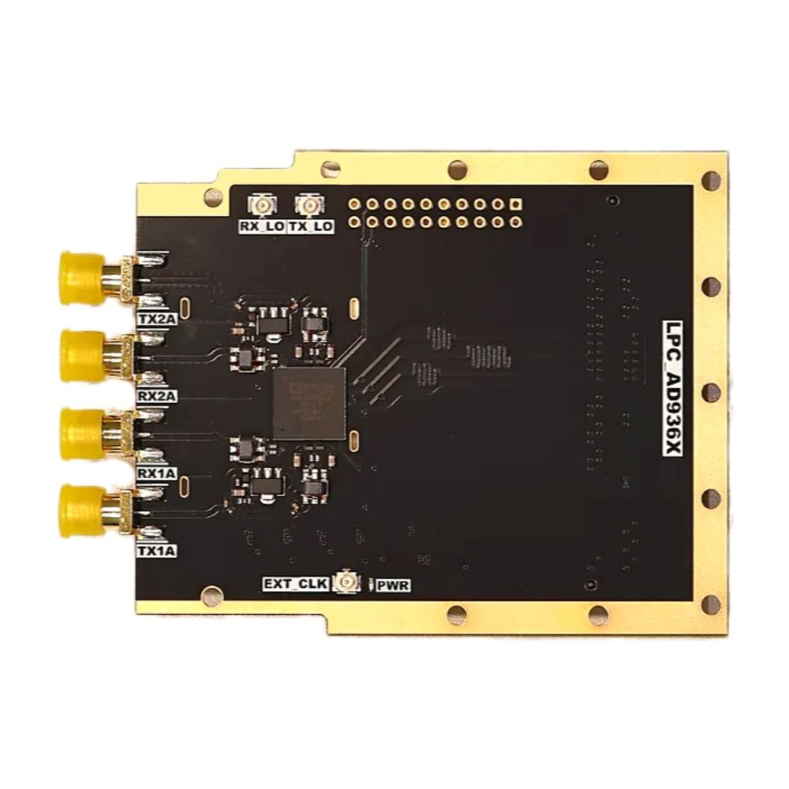
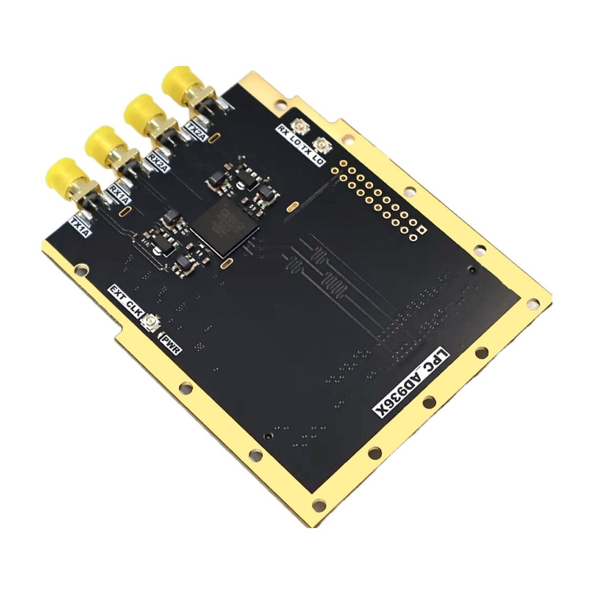

# FMC-AD936X

Schematic, Vivado reference design and bare-metal test application for the **OpenSourceSDRLab FMC-AD936X** (FMC-936X), an FMC (LPC) card with the Analog Devices AD9361 or AD9363 RF transceiver and the same FMC signal assignment as the AD-FMCOMMS2-EBZ.

  
  

## Product link

<https://opensourcesdrlab.com/products/opensourcesdrlab-fmc-936x-high-quality-development-board-card-with-lpc-interface-replacement-for-fmcomms2>

## About the board

- RF transceiver: Analog Devices **AD9361** (FMC-9361) or **AD9363** (FMC-9363), two transmit and two receive channels on SMA connectors (TX1A/TX2A, RX1A/RX2A)
- Transmit path: a **PGA-102+** amplifier on each transmit output
- Clocking: on-board 40 MHz reference oscillator, EXT CLK connector, external LO inputs (TX LO, RX LO)
- Interface: FMC **LPC** connector with the same signal assignment as the Analog Devices AD-FMCOMMS2-EBZ, so FMCOMMS2 reference designs run on it; LVDS data port, SPI and control signals to the carrier FPGA
- Compared with the AD-FMCOMMS2-EBZ, the power-monitor chip and the FMC EEPROM are not fitted
- Power from the carrier through the FMC connector (12 V, 3.3 V and VADJ)
- Tested carrier: Xilinx **ZC706** (XC7Z045), FMC LPC connector
- Reference design: Vivado / Vitis **2021.1**, Analog Devices HDL `hdl_2021_r1` and no-OS `2021_R1`, bare-metal (no OS)

## Quick start

1. Fit the board on the ZC706 LPC connector and connect TX1A to RX1A through an attenuator of at least 30 dB.
2. Load the prebuilt files from the [Releases](../../releases) page over JTAG or from an SD card.
3. Open the ZC706 serial console at 115200 baud and check the printed I/Q samples.

The full steps are in the **[Quick Start Guide](docs/Quick-Start-Guide.md)** ([PDF](docs/Quick-Start-Guide.pdf)).

## Repository layout

| Path | Contents |
|---|---|
| `hardware/` | Board schematic (PDF) |
| `vivado/ZC706/FMC_AD936X_PL/` | FPGA design: Analog Devices HDL reference design `projects/fmcomms2/zc706` and the HDL libraries it uses (build with `make`) |
| `vivado/ZC706/FMC_AD936X_PS/` | Bare-metal application sources (Analog Devices no-OS AD9361 example, configured for this board) and the hardware platform `system_top.xsa` |
| `docs/` | Quick Start Guide (Markdown and PDF) |
| `images/` | Product photos |

## Downloads (Releases)

Large files are attached to the [Releases](../../releases) page instead of being stored in the repository:

| File | Contents |
|---|---|
| `FMC-AD936X_ZC706_prebuilt_Vivado2021.1.zip` | Prebuilt files for the ZC706: bitstream, `.xsa`, FSBL and application `.elf` |
| `SHA256SUMS.txt` | SHA-256 checksums of the files above |

Check a download with `shasum -a 256 -c SHA256SUMS.txt` (macOS / Linux) or `certutil -hashfile <file> SHA256` (Windows).

## Licence

Files created by OpenSourceSDRLab are released under the [Apache License 2.0](LICENSE). The reference designs come from Analog Devices and Xilinx/AMD and remain under their own licences; see [NOTICE.md](NOTICE.md).

## Support

- Email: support@opensourcesdrlab.com
- Forum: <https://forum.opensourcesdrlab.com>
- Discord: <https://discord.gg/nnxY6DkmvT>
- Blog and user manuals: <https://blog.opensourcesdrlab.com>

---
© 2026 OpenSourceSDRLab. All rights reserved. · <a href="https://www.opensourcesdrlab.com">www.opensourcesdrlab.com</a>
